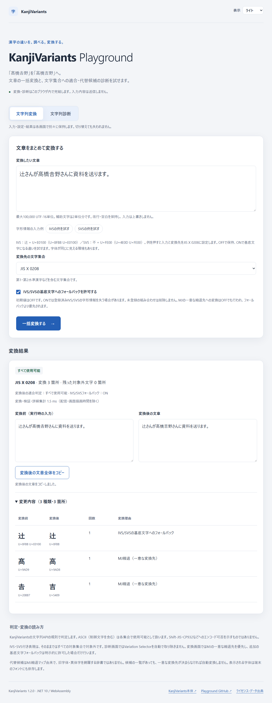
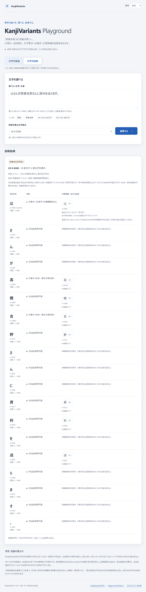

# KanjiVariants Playground

**漢字の違いを、調べる。変換する。**

「髙」と「高」、「𠮷」と「吉」。異体字を含む文章の一括変換と、文字ごとの診断を試せるWebアプリです。.NETライブラリ **KanjiVariants** の機能を、ブラウザから利用できます。

## ブラウザで試す

**[KanjiVariants Playgroundを開く](https://koichi-kobayashi.github.io/KanjiVariants.Playground/)**

インストール不要です。文章を入力し、変換先の文字集合を選んで「一括変換する」を押してください。文字ごとの判定や候補を見たいときは「文字列診断」に切り替えます。

変換・診断はブラウザ内で完結し、入力内容を外部サーバーへ送信しません。元の入力は上書きせず、結果を確認してからコピーできます。画面を切り替えても、それぞれの入力・設定・結果を保持します。

## 変換例

変換先を **JIS X 0208** にした場合：

| 状態 | 文章 |
| --- | --- |
| 変換前 | **髙**橋**𠮷**野さんに資料を送ります。 |
| 変換後 | **高**橋**吉**野さんに資料を送ります。 |

変換できない文字は残ります。例えば「髙😀」は「高😀」になり、絵文字が残るため文章全体は対象文字集合に収まりません。画面で変換後の判定も確認できます。

## 画面

### 文章一括変換

変換前後を並べて比較し、変更数、変換理由、変換後の適合性を確認できます。  
変更内容を展開すると、どの文字がどの理由で変換されたか（MJ縮退 / IVS・SVSの基底文字フォールバック）も確認できます。



### 文字列診断

元の文字の判定、コードポイント、代替候補とその種類を確認できます。  
異体字のMJ候補と、登録済みIVS/SVSの基底文字フォールバック候補を区別して表示します。

さらに、ローカル実装済みの漢字詳細表示では、各行の「詳細」を押すと、JIS文字集合への所属、常用漢字の掲載音訓、教育漢字の配当学年、人名用漢字の分類を確認できます。複数の行を同時に展開でき、同じ行の「詳細」をもう一度押すと閉じます。**この詳細表示は、現在の公開サイトにはまだ反映していません。**



## 主な機能

- **学年別ふりがな（P2b・ローカル追加）**：小学1〜6年までの未習漢字へ、Lindera 6.2.0＋IPADICで自動読みを付けます。初回利用時だけ辞書を読み込み、ブラウザ内のWorkerで解析します。手動編集・熟語の分割と結合・ルビ表示切替・括弧付きコピーも利用できます。手動修正は再生成で保持します。推定読みは未確認の候補です。[P1仕様](docs/FURIGANA.md)・[P2b実装と検証](docs/FURIGANA-P2B.md)を参照してください。ローカル構成は[固定ソースからの自前WASM](docs/FURIGANA-SELF-BUILD.md)へ移行しました。確認した依存範囲の必要通知は充足していますが、公開承認は保留し、Pages公開前チェックで停止します。公開サイトへの反映は行っていません。

- **文章の一括変換**：変換前後の比較、変更箇所・理由・出現回数の表示、変換結果の全文コピー。
- **文字列診断**：文字ごとの適合判定と、異体字・MJ縮退マップに基づく代替候補の表示・コピー。元の文字を押すと、JIS所属・常用漢字の掲載音訓・教育漢字の配当学年・人名用漢字の分類を行内に展開できます。MJ縮退は、文字情報データで定められた代替文字への変換です。候補には元と同じ文字が含まれる場合もあります。
- **IVS/SVSの確認**：漢字に字形指定を付けた表現を診断し、MJ候補と基底文字へのフォールバック候補を区別。入力例からON/OFFの違いを試せます。
- **Unicodeコードポイント**：文字を識別する番号を表示。字体の違いが見えにくい環境でも確認できます。
- **表示テーマ**：ライト・ダーク・システムに対応。PC・スマートフォン向けのレスポンシブレイアウトを採用しています。

対象は **JIS X 0208、JIS X 0212、JIS X 0213 第1面・第2面・全体** の5種類です。JIS X 0212はJIS X 0208を含まない独立した集合、第2面は第1面を含まない集合です。

漢字詳細表示の実装範囲と検証結果は[漢字詳細P1](docs/CHARACTER-DETAILS.md)を参照してください。

## 変換時の注意

- 対象集合で使える文字は維持し、変換できない文字は元のまま残します。改行・空白を削除したり、入力を正規化したりしません。
- 候補が複数あっても、先頭を勝手に選びません。ライブラリが一意に決められる変換先だけを使用します。
- **IVS/SVSの基底文字フォールバックは初期値OFF**です。字形指定付き表現は、そのままでは対象文字集合外です。ONでは字形情報を失う場合があります。これはMJ縮退とは別の処理で、MJの一意な縮退はOFFでも行われ、ONでも優先されます。未登録の組み合わせは独自判断で削除しません。
- **JIS文字集合への適合と、Shift-JIS／CP932へのエンコード可否は別の概念**です。ASCIIは制御文字を含めて使用可能とする、KanjiVariantsの規則で判定します。
- 氏名などの正式な表記に利用する場合は、変換結果を利用者が確認してください。表示される字体は端末のフォントにも依存します。

入力上限は変換100,000、診断2,000 UTF-16単位です。補助文字は2単位分、字形指定も追加の単位数を使います。上限を超えた入力は切り捨てずエラーにします。長文処理中は画面操作が待たされる場合があります。

詳しい規則は[一括変換の仕様](docs/CONVERSION.md)と[IVS/SVSの候補・優先順位](docs/VARIATIONS.md)を参照してください。

## 使用技術

- .NET 10 / C# / Blazor WebAssembly Standalone
- [KanjiVariants本体](https://github.com/Koichi-Kobayashi/KanjiVariants) / [NuGet 1.2.1](https://www.nuget.org/packages/KanjiVariants/1.2.1)
- GitHub Pages / GitHub Actions

初回にアプリ・.NETランタイム・文字データを取得し、その後の変換・診断はブラウザ内で実行します。ASP.NET Coreのサーバープロジェクト、分析SDK、外部フォント、変換・診断用の外部APIは使用していません。

## 開発者向け

### ローカル起動

[.NET 10 SDK](https://dotnet.microsoft.com/download/dotnet/10.0) **10.0.401**を用意し、リポジトリのルートで実行します。`global.json`とCIでSDKを固定しています。SDK・パッケージを更新するときはlock fileとライセンス通知も確認してください。

このアプリはAOTを使用せず、`Directory.Build.props`で任意の追加workloadの解決を無効にしています。Visual Studioに別版のWASM workloadがインストールされていても、固定SDKと同じ暗黙依存・ブラウザランタイム（10.0.12）を使用します。AOTや追加workloadを正式採用する場合は、この設定・lock・配布ランタイム・通知をまとめて再検証してください。

```powershell
dotnet restore --locked-mode
dotnet build
dotnet run --project src/KanjiVariants.Playground --launch-profile http
```

`http://localhost:5175`を開きます。初期画面は文字列変換、初期入力は上の例文、変換先はJIS X 0208です。

### Releaseビルド・起動

```powershell
dotnet build -c Release --no-restore
dotnet run --project src/KanjiVariants.Playground -c Release --launch-profile release-http
```

Visual Studioでは構成を**Release**、プロファイルを**release-http**にして、**Ctrl+F5**で開始できます。通常のビルド・起動に`wasm-tools`は必須ではありません。開発プロファイル・デバッガーの違いは[検証記録](docs/VALIDATION.md#release起動プロファイルの追加確認)を参照してください。

### PDB・配布パスの検証

Debug/ReleaseでSDKのSourceRootとSourceLinkを同時に正規化します。SDK10のRazor生成ソースに残る位置指定は、ファイル生成段階で相対化してからコンパイルし、PDBと埋め込みソースを保持します。依存バージョンや字形判定は変更しません。

```powershell
dotnet build -c Debug --no-restore
dotnet build -c Release --no-restore
dotnet run --project tools/VerifyPlaygroundArtifacts -c Release -- .
node scripts/Verify-KanjiVariantsDistribution.mjs
node scripts/Verify-PlaygroundDistribution.mjs
```

コミット済みのclean checkoutでは検証器に`--git`を追加し、PDB文書チェックサムをHEADのGit blobへ直接照合します。未PushのSourceLink実URLの取得確認は別工程です。

### 仕様の検証

```powershell
dotnet run --project tests/KanjiVariants.Playground.Checks -c Release
```

独自のコンソール検証プログラムで、公開API・本体の正式な仕様例・Unicode境界を照合します。**`dotnet test`だけではこの検証は実行されません。** 本体の全テストを実行するものではありません。

| 資料 | 内容 |
| --- | --- |
| [ライブラリ調査](docs/RESEARCH.md) | 公開API・WebAssembly互換性・データと初期化 |
| [初期構築の検証記録](docs/VALIDATION.md) | 実測・起動設定・Pages公開物の準備 |
| [一括変換の仕様](docs/CONVERSION.md) | API・サービス／コンポーネント構成・集計・長文の検証 |
| [IVS/SVSの改善記録](docs/VARIATIONS.md) | 登録済み入力例・候補の由来・優先順位・1,547件の検証 |
| [漢字詳細P1](docs/CHARACTER-DETAILS.md) | 複数行の詳細展開・遅延取得・キャッシュ・1,752件の検証 |

## GitHub Pagesへの公開

自動ふりがなの認証には[案Bの保証範囲と公開ゲート](docs/FURIGANA-ATTESTATION.md)を使用します。固定配布物、記録された106コンパイル依存、公式Rust標準入力54ファイル、宣言範囲の必要通知を独立証跡で照合します。完全な最終リンクSBOMを証明するものではありません。原来歴の未証明評価は保持し、技術検証が成功しても`publicationApproved=false`ならアップロード・デプロイを停止します。今回の保証範囲の承認は、正式公開の承認ではありません。

[公開サイト](https://koichi-kobayashi.github.io/KanjiVariants.Playground/)で一括変換・診断・IVS/SVS入力例を利用できます。[Playgroundのソースコード](https://github.com/Koichi-Kobayashi/KanjiVariants.Playground)はこのリポジトリで管理しています。

[Pagesワークフロー](.github/workflows/pages.yml)は、`main`へのPushまたは手動実行で復元・Releaseビルド・仕様検証・publishを行い、GitHub公式Pages Actionsでデプロイします。

公開先を設定する場合は **Settings → Pages → Source** を **GitHub Actions** にし、Actionsの実行許可と`github-pages` Environmentの保護ルールを確認してください。ワークフローの配置だけではPages設定は完了しません。

サブパス`/KanjiVariants.Playground/`、静的ファイル、ローカルの公開物検証コマンドは[Pages公開物の準備・検証](docs/VALIDATION.md#pages公開物の準備検証)を参照してください。

## ライセンスと出典

Playground独自コードは[MIT License](LICENSE)です。**依存関係と外部文字データには、それぞれの利用条件が適用されます。**

IPAのMJデータはCC BY-SA 2.1 JP、Unicode関連データはUnicodeの条件、ICU対応表はUnicode・ICU通知、文部科学省・文化庁由来の資料は文部科学省ウェブサイト利用規約に従います。JIS X 0208は固定Unicode JIS0208.TXT Table 2.0（legacy mapping）とUnicode License V3に基づき、1区32点の互換処理を維持しています。正式1.2.1の原典・許諾全文・通知を配信し、今回の配布についてA1を解除した評価を[公開前監査](docs/PREPUBLICATION-AUDIT.md)に記録しています。公開承認は保留です。

詳細と著作権・許諾本文は[ライセンス・出典通知](LICENSE-NOTICES.md)と[保存した第三者通知](THIRD-PARTY-NOTICES/)を参照してください。[Webサイトのライセンス画面](https://koichi-kobayashi.github.io/KanjiVariants.Playground/licenses.html)からも確認できます。これらを一律にMITとして扱いません。

## 今後の追加予定

### 学年別ふりがな（開発予定）

小学1〜6年生の学年を選び、**その学年までに習っていない漢字を含む箇所だけ**にふりがなを付ける機能を検討しています。すべての漢字に一律にふりがなを付けるものではありません。

段階的な実装を予定しています。

1. **P1：手動ふりがな** — KanjiVariantsの教育漢字診断APIで未習漢字を検出し、利用者が読みとルビ範囲を指定してプレビューします。「今日（きょう）」のように熟語全体へ読みを付けられる設計を想定しています。
2. **P2：自動読み推定** — 日本語の形態素解析ライブラリを比較・検証したうえで、読みの候補を自動生成し、必要に応じて手動修正できるようにします。

学年による判定は教育漢字の**配当学年**を基準とするため、実際に読める漢字・熟語と完全に一致するわけではありません。また、同じ漢字でも文脈により読みが変わるため、自動推定した読みを必ず正しいものとして扱わない方針です。

**この機能は現在の公開サイトでは利用できません。**

### その他の追加候補

教育漢字・常用漢字・人名用漢字の文章全体の診断、MJ文字情報の詳細、TXT・CSVファイル診断、結果のダウンロードを検討しています。単一の文字の漢字表情報は行内詳細で確認できますが、これらの追加機能は現在の画面では未実装です。AOTや配信最適化も、計測しながら検討します。
